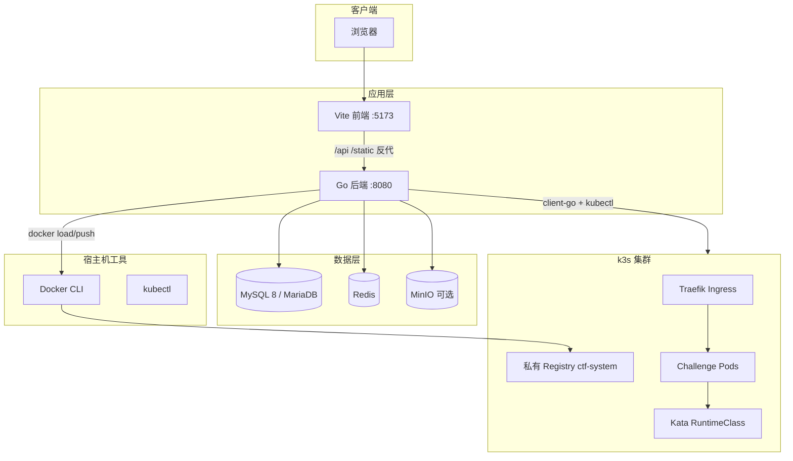

# CTF Exec 项目环境配置

> **版本**：v1.2  
> **适用代码库**：`ctf_exec`（platform / contest 双 Scope CTF 平台）  
> **最后更新**：2026-05-22

本文档描述 CTF Exec **启动前**需要准备的所有基础设施、软件版本、环境变量与验收步骤。按本文完成配置后，方可正常进行题目发布、镜像构建与容器实例启停。

---

## 1. 架构总览



**启动时后端自动完成的 Bootstrap（无需手工部署）：**

| 动作 | 说明 |
|------|------|
| 连接 k3s | 通过 `KUBECONFIG_PATH` 或 in-cluster config |
| 部署私有镜像仓库 | Namespace `ctf-system`，StorageClass `local-path`，NodePort 暴露 |
| 配置 Docker insecure registry | 写入 `/etc/docker/daemon.json` 并 reload Docker |
| 初始化数据库 | 若库不存在，执行 `db/final.sql` |
| 初始化 MinIO 桶 | `MINIO_ENABLED=true` 时按题型创建 bucket |
| 创建 root 用户 | 使用 `ROOT_DEFAULT_PASSWORD` |

**需运维预先准备（后端不会代装）：**

- **k3s / Kubernetes 集群完整环境**：含 Traefik、local-path、**Kata Containers + RuntimeClass `kata`**
- MySQL / Redis / MinIO 服务
- Web 题泛域名 DNS、TLS 证书（生产环境）

> CTF Exec 容器题默认 `use_kata=true`，Pod 会指定 `runtimeClassName: kata`。**安装 k3s 时必须同步完成 Kata 与 RuntimeClass 配置**，否则实例启动必然失败。

---

## 2. 组件清单与版本要求

### 2.1 必需组件

| 组件 | 最低版本建议 | 用途 | 备注 |
|------|-------------|------|------|
| **Go** | 1.26+ | 编译运行后端 | 见 `backend/go.mod` |
| **Node.js** | 18+（推荐 20 LTS） | 前端开发与构建 | 配合 npm |
| **MySQL** | 8.0 或 **MariaDB 10.6+** | 主业务数据 | 字符集 `utf8mb4` |
| **Redis** | 6+ | 会话、限流、排行榜缓存 | 建议开启 AOF |
| **k3s** | 1.28+（当前测试 v1.34） | 容器题编排 | 自带 Traefik、local-path |
| **Kata Containers** | 与 k3s 同版本节点一并安装 | 容器沙箱（VM 级隔离） | RuntimeClass 名 `kata` |
| **kubectl** | 与 k3s 版本匹配 | 实例 Pod/Service/Ingress | 后端 shell 调用 |
| **Docker Engine** | 20.10+ | 题目镜像 `docker load/tag/push` | 构建流水线依赖 |

### 2.2 条件必需 / 推荐组件

| 组件 | 何时需要 | 用途 |
|------|---------|------|
| **MinIO** | `MINIO_ENABLED=true` | 题目附件对象存储 |
| **Resend** | 启用邮箱验证 | 邮件 API |
| **Cloudflare Turnstile** | `TURNSTILE_ENABLED=true` | 注册/登录人机验证 |
| **Nginx / 反向代理** | 生产统一入口 | 例如 `:8089` 反代前后端 |
| **cert-manager** | Web 题 HTTPS | 配合 `INGRESS_TLS_*` |

---

## 3. 硬件与操作系统建议

| 资源 | 建议 |
|------|------|
| CPU | 4 核+，**必须**支持硬件虚拟化（Kata 依赖 VT-x / AMD-V） |
| 内存 | 16 GB+（Kata 每 Pod 额外约 100–200 Mi） |
| 磁盘 | 50 GB+（镜像 tar、Registry PVC 默认 30Gi） |
| OS | Ubuntu 22.04 / 24.04 LTS（下文命令以此为例） |

生产环境另需：Web 题泛域名 DNS（`*.chal.example.com`）、Pwn/TCP 题 NodePort 防火墙放行。

---

## 4. 推荐安装顺序

```
1. 系统基础（curl、jq、git）
2. Docker Engine
3. k3s / k8s 集群（含 Kata + RuntimeClass + 网络验收）  ← 一步做完，不可拆分
4. MySQL
5. Redis
6. MinIO（若启用附件存储）
7. 克隆项目 → 配置 .env
8. 启动后端（触发 Registry Bootstrap）
9. 启动前端 / 构建生产静态资源
10. 全链路验收
```

---

## 5. 基础工具安装

### 5.1 Go

```bash
go version   # 应 >= go1.26
```

后端工作目录为 `backend/`，启动时引用 `../db/final.sql` 与 `../static`。

### 5.2 Node.js 与前端

```bash
cd frontend
npm install
npm run dev    # http://0.0.0.0:5173，/api 反代至后端
```

前端 Vite 从**项目根目录**加载 `.env`，与后端共用。

### 5.3 Docker

```bash
curl -fsSL https://get.docker.com | sh
systemctl enable --now docker
docker version
```

后端启动后会将私有 Registry NodePort 写入 `/etc/docker/daemon.json` 的 `insecure-registries`；需保证后端进程有权限修改该文件（通常 root 运行，或预先手工配置）。

---

## 6. MySQL

```bash
docker run -d --name ctf-mysql \
  -e MYSQL_ROOT_PASSWORD=your_root_password \
  -e TZ=Asia/Shanghai \
  -p 3306:3306 \
  mysql:8.0
```

| 环境变量 | 说明 |
|---------|------|
| `DB_HOST` / `DB_PORT` | 默认 `127.0.0.1:3306` |
| `DB_USER` / `DB_PASSWORD` | 连接账号 |
| `DB_NAME` | 默认 `ctf_exec` |

后端首次启动时，若库不存在则自动执行 `db/final.sql`；已有库不会重复初始化。

---

## 7. Redis

```bash
docker run -d --name ctf-redis \
  -p 6379:6379 \
  -v ./data/redis:/data \
  redis:7 \
  redis-server --requirepass your_redis_password --appendonly yes
```

用途：会话、限流、排行榜、shared 实例缓存。配置见 `.env` 中 `REDIS_*`。

---

## 8. MinIO（可选）

`MINIO_ENABLED=true` 时，启动自动创建 bucket：`{MINIO_BUCKET_PREFIX}-attachments-{web|pwn|crypto|reverse|misc}`。

```bash
docker run -d --name ctf-minio \
  -p 9000:9000 -p 9001:9001 \
  -v /data/minio:/data \
  -e MINIO_ROOT_USER=minioadmin \
  -e MINIO_ROOT_PASSWORD=minioadmin123 \
  quay.io/minio/minio server /data --console-address ":9001"
```

纯容器题、不用附件时可设 `MINIO_ENABLED=false`。

---

## 9. k3s / Kubernetes 集群环境（完整安装）

本章为容器题的**完整集群前置**。CTF Exec 要求集群同时满足：

| 能力 | 说明 |
|------|------|
| k3s（或兼容 k8s） | 控制面 + 工作节点 Ready |
| StorageClass | `local-path`（k3s 默认） |
| Ingress | Traefik（k3s 默认） |
| Kata runtime | containerd 注册 `kata` handler |
| RuntimeClass | 名为 `kata`，与 `.env` 中 `KATA_RUNTIME_CLASS` 一致 |
| 硬件虚拟化 | `/dev/kvm` 可用 |

以下以 **单节点 k3s** 为例；多节点集群需在**每个会调度 challenge Pod 的节点**重复 Kata 与 containerd 配置步骤。

---

### 9.1 节点前置：硬件虚拟化

```bash
# CPU 须含 vmx（Intel）或 svm（AMD）
grep -E '(vmx|svm)' /proc/cpuinfo | head -1

# 加载 KVM 模块
modprobe kvm
modprobe kvm_intel    # Intel
# modprobe kvm_amd    # AMD

ls -l /dev/kvm        # 须存在且可访问
```

BIOS 须开启虚拟化；若在 VM 内跑 k3s，需开启嵌套虚拟化。

---

### 9.2 安装 k3s

```bash
curl -sfL https://get.k3s.io | sh -

# 验证控制面
kubectl get nodes
# 预期：STATUS=Ready

kubectl get storageclass
# 预期：local-path (default)

kubectl get ingressclass
# 预期：traefik
```

**kubeconfig**（写入 `.env`）：

```env
KUBECONFIG_PATH=/etc/rancher/k3s/k3s.yaml
```

非 root 运行后端时：

```bash
mkdir -p ~/.kube
cp /etc/rancher/k3s/k3s.yaml ~/.kube/config
chown $(id -u):$(id -g) ~/.kube/config
```

---

### 9.3 安装 Kata Containers（k3s 节点必做）

k3s 已内置 containerd，**不要**安装第二套 containerd。推荐直接解压官方静态包到 `/opt`（见下方说明）。

> **不要用 `kata-manager.sh -o` 装最新版**：当前 release 为 `kata-static-*.tar.zst`，脚本解压时**未加 `-C /`**，会把文件解到当前目录 `./opt/kata/` 而非 `/opt/kata/`，随后报：
> `ERROR: Kata Containers does not exist in expected directory /opt/kata/bin`

**推荐：手动安装静态包**

```bash
apt-get install -y curl jq zstd   # 或 yum install zstd

cd /tmp
KATA_VER=$(curl -sL https://api.github.com/repos/kata-containers/kata-containers/releases/latest | jq -r '.tag_name')
ARCH=$(uname -m); case "$ARCH" in x86_64) KARCH=amd64;; aarch64) KARCH=arm64;; esac

# 优先 .tar.zst（当前默认格式）
curl -fL -o kata-static.tar.zst \
  "https://github.com/kata-containers/kata-containers/releases/download/${KATA_VER}/kata-static-${KATA_VER}-${KARCH}.tar.zst"

# 必须 -C /，解到 /opt/kata
tar --zstd -xf kata-static.tar.zst -C /

/opt/kata/bin/kata-runtime --version
ln -sf /opt/kata/bin/containerd-shim-kata-v2 /usr/local/bin/containerd-shim-kata-v2
ln -sf /opt/kata/bin/kata-runtime /usr/local/bin/kata-runtime
```

若 release 仅有 `.tar.xz`，则改用：

```bash
tar -xvf kata-static-${KATA_VER}-${KARCH}.tar.xz -C /
```

**若已误跑 kata-manager 且报错**：文件可能在 `/tmp/tmp.*/opt/kata` 或当前目录 `./opt/kata`，任选其一修复：

```bash
# 情况 A：/tmp 下临时目录里已有 opt/kata
sudo mv /tmp/tmp.*/opt/kata /opt/kata

# 情况 B：当前目录下有 opt/kata（先 pwd 确认）
sudo mv ./opt/kata /opt/kata
```

---

### 9.4 将 Kata 注册进 k3s containerd

```bash
mkdir -p /var/lib/rancher/k3s/agent/etc/containerd

cat > /var/lib/rancher/k3s/agent/etc/containerd/config-v3.toml.tmpl <<'TOML'
{{ template "base" . }}

[plugins.'io.containerd.cri.v1.runtime'.containerd.runtimes.'kata']
  runtime_type = "io.containerd.kata.v2"
  privileged_without_host_devices = true
  pod_annotations = ["io.katacontainers.*"]
  container_annotations = ["io.katacontainers.*"]
  [plugins.'io.containerd.cri.v1.runtime'.containerd.runtimes.'kata'.options]
    ConfigPath = "/opt/kata/share/defaults/kata-containers/configuration.toml"
TOML

rm -f /var/lib/rancher/k3s/agent/etc/containerd/config.toml
systemctl restart k3s

# 确认 kata 已写入运行时配置
grep -A3 "runtimes.'kata'" /var/lib/rancher/k3s/agent/etc/containerd/config.toml
```

较旧 k3s 若使用 `config.toml.tmpl`（v2 模板），插件段名改为 `io.containerd.grpc.v1.cri`，其余 handler 名仍为 `kata`。

---

### 9.5 创建 RuntimeClass

平台默认 `KATA_RUNTIME_CLASS=kata`，**名称必须一致**：

```bash
kubectl apply -f - <<'EOF'
apiVersion: node.k8s.io/v1
kind: RuntimeClass
metadata:
  name: kata
handler: kata
EOF

kubectl get runtimeclass
# 预期：列表中含 kata（handler=kata）
```

> 集群若已有 kwasm 等其它 RuntimeClass（wasmedge、crun 等），与 CTF Exec 无关，**不能替代 `kata`**。

---

### 9.6 集群验收（必须通过后再启动后端）

```bash
# 1. 节点与基础组件
kubectl get nodes
kubectl get storageclass
kubectl get ingressclass

# 2. RuntimeClass
kubectl get runtimeclass kata

# 3. Kata Pod 冒烟
kubectl run kata-smoke --rm -it --restart=Never \
  --image=busybox:latest \
  --overrides='{"spec":{"runtimeClassName":"kata"}}' \
  -- sh -c "echo kata-ok"

# 4. 清理（若未 --rm）
# kubectl delete pod kata-smoke --ignore-not-found
```

任一失败则回到 9.1–9.5 排查，**不要**先启动 CTF Exec 后端。

---

### 9.7 容器题网络（Ingress / NodePort）

**Web 题（container_web）**

- 经 Traefik Ingress 暴露子域名
- `.env`：`INGRESS_DOMAIN_TEMPLATE={id}.chal.example.com`，`INGRESS_CLASS=traefik`
- DNS：`*.chal.example.com` A 记录 → k3s 节点 IP

**Pwn / TCP 题（container_tcp）**

- Service 类型 NodePort
- 访问地址 `{节点IP}:{NodePort}`；节点名由 `INFRA_NODE_NAME` 或 hostname 决定

**TLS（生产可选）**

```env
INGRESS_TLS_ENABLED=true
INGRESS_TLS_SECRET=wildcard-chal-tls
```

需预先在集群创建对应 TLS Secret，或配合 cert-manager。

---

### 9.8 平台在集群中创建的资源

| 资源 | Namespace | 创建时机 |
|------|-----------|---------|
| Registry Deployment/Service/PVC | `ctf-system` | **后端首次启动** Bootstrap |
| 用户实例 Namespace | `ctf-{userId}` 或 `ctf-shared` | 选手启动实例 |
| Pod / Service / Ingress | 上述 Namespace | 同上 |

**Registry（后端自动部署，无需手工装）**

- 镜像 `registry:2`，PVC `REGISTRY_STORAGE_SIZE`（默认 30Gi，`local-path`）
- NodePort 暴露于 `127.0.0.1:<port>`，凭证打印在后端启动日志
- 构建链：`docker load → tag → push → HTTP 校验`

多节点时固定 Registry 节点：

```env
INFRA_NODE_NAME=ntpcy
```

**实例 Pod 与 Kata 的关系**

- 题目 `use_kata` 默认 `true`（库表默认 `1`）
- 启动实例时写入 `runtimeClassName: kata`（见 `problem_k8s_helpers.go`）
- 因此 9.3–9.6 是集群安装的**必要组成部分**，不是可选项

---

## 10. 环境变量配置（`.env`）

```bash
cp .env.example .env
```

### 10.1 启动硬性要求

| 变量 | 要求 |
|------|------|
| `JWT_SECRET` | 非空且不能为默认占位符 |
| `KUBECONFIG_PATH` | 指向已完成 §9 验收的集群 |
| `KATA_RUNTIME_CLASS` | 默认 `kata`，与集群 RuntimeClass 一致 |
| MySQL / Redis | 可连接 |

### 10.2 容器 / 集群相关

```env
KUBECONFIG_PATH=/etc/rancher/k3s/k3s.yaml
MAX_CONCURRENT_CONTAINERS=3
DEFAULT_CONTAINER_TTL=3600
NAMESPACE_PREFIX=ctf
INFRA_NODE_NAME=
KATA_RUNTIME_CLASS=kata

INGRESS_DOMAIN_TEMPLATE={id}.chal.example.com
INGRESS_CLASS=traefik
INGRESS_TLS_ENABLED=false
INGRESS_TLS_SECRET=

FLAG_TEMPLATE=flag{%s}
REGISTRY_STORAGE_SIZE=30Gi
# REGISTRY_HOST / REGISTRY_USERNAME / REGISTRY_PASSWORD 由后端启动注入，勿填
```

完整变量见 `.env.example`。

---

## 11. 项目启动流程

### 11.1 检查清单

- [ ] §9 集群验收全部通过（含 `RuntimeClass kata` 与冒烟 Pod）
- [ ] MySQL、Redis 已运行
- [ ] Docker 已安装
- [ ] `.env` 已配置且 `JWT_SECRET` 已修改
- [ ] MinIO 就绪（若 `MINIO_ENABLED=true`）

### 11.2 启动

```bash
# 后端（在 backend/ 目录）
go run main.go

# 前端（在 frontend/ 目录）
npm run dev
```

预期后端日志含：`Kubernetes 客户端已连接`、`私有镜像仓库已就绪`。

### 11.3 业务验收

发布容器题 → build success → 启动实例 → 获得 access_url → 提交 Flag。

---

## 12. 常见问题

| 现象 | 原因与处理 |
|------|-----------|
| `RuntimeClass "kata" not found` | §9 未完成：补装 Kata、注册 containerd、创建 RuntimeClass |
| `does not exist in expected directory /opt/kata/bin` | kata-manager 解压路径错误；改用手动 `tar --zstd -xf ... -C /` 或 `mv opt/kata /opt/kata` |
| `kata-manager: containerd already installed` | 勿用默认模式；改 §9.3 手动静态包安装 |
| `failed ... /dev/kvm` | §9.1 虚拟化未开或未加载 kvm 模块 |
| 镜像 push 失败 | Docker `insecure-registries` 未含 Registry NodePort |
| 后端连不上 k3s | `KUBECONFIG_PATH` 错误或权限不足 |
| Web 题 URL 不可达 | 泛域名 DNS / Traefik / 防火墙 |
| 后端拒绝启动 | 修改 `JWT_SECRET` |

---

## 13. 相关文件索引

| 路径 | 说明 |
|------|------|
| `.env.example` | 环境变量模板 |
| `db/final.sql` | 数据库 DDL |
| `backend/main.go` | k8s 连接 + Registry Bootstrap |
| `backend/internal/k8s/registry.go` | 私有仓库部署 |
| `backend/internal/repository/problem_k8s_helpers.go` | Pod manifest、`runtimeClassName` |
| `frontend/vite.config.ts` | 开发反代 |
| `note/env_note.txt` | 容器/Flag 设计备忘 |

---

## 14. 版本记录

| 版本 | 日期 | 说明 |
|------|------|------|
| v1.0 | 2026-05-22 | 首版 |
| v1.1 | 2026-05-22 | 将 Kata 并入 §9 k3s 完整安装流程；明确集群与 Kata 一体交付，不再单独成章 |
| v1.2 | 2026-05-22 | §9.3 改用手动 tar 安装；记录 kata-manager 对 .tar.zst 解压路径 bug |
